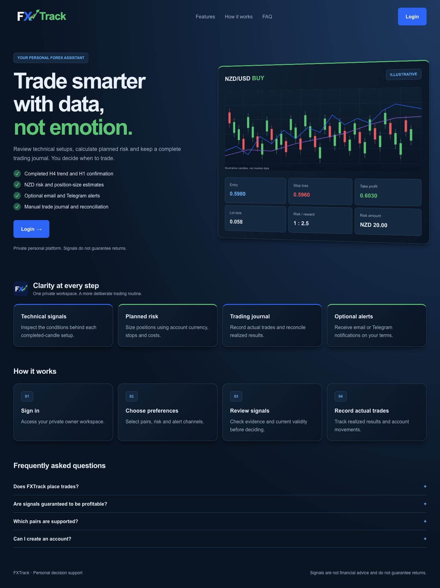
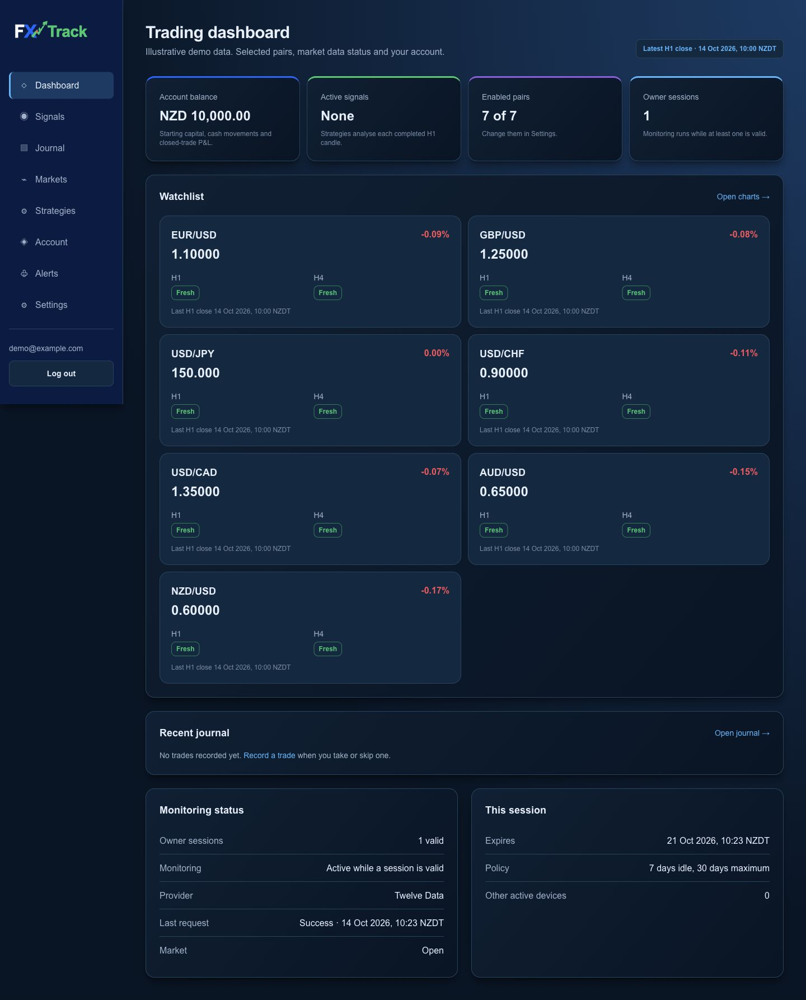

# FXTrack

> A private forex monitoring and trading journal application for a New Zealand trader, with completed-candle signals, NZD risk calculations and an auditable account ledger.

[**Source Code**](https://github.com/MohamedHNoor/fxtrack) · [**Deployment Guide**](docs/railway.md)

---

## Overview

FXTrack brings market data, trade planning and actual trading records into one owner-only workspace. It monitors seven currency pairs at H1 and H4, explains the evidence behind each strategy verdict, calculates position sizes from NZD capital and records the trades the owner takes or skips.

Signals propose trades; they never place orders or move capital. The journal records actual broker fills separately from the planned entry, stop and target. Closed trades reconcile into the account ledger, including fees, financing and explained manual overrides.

The application is under development. Its Twelve Data feasibility gate still requires passing live evidence, and Railway deployment has been prepared but is not established by the local checks below. Telegram alerts, performance reports and backtests remain planned work.

---

## Key Features

- Owner-only login, password recovery, expiring sessions and device revocation, with no public registration
- A market dashboard and candlestick charts for EUR/USD, GBP/USD, USD/JPY, USD/CHF, USD/CAD, AUD/USD and NZD/USD
- Pair selection, history warm-up and visible data freshness and provider status
- An NZD account ledger with deposits, withdrawals, adjustments and traceable reversals
- Percentage-based or fixed risk, currency conversion and cost-adjusted position sizing
- Editable, versioned Trend Pullback Confirmation strategies using completed H4 and H1 candles
- BUY, SELL and WAIT evidence, signal expiry and invalidation, and correlated USD exposure warnings
- Opt-in email alerts with retries, duplicate-send protection and visible delivery failures
- A manual trading journal with actual fills, realized NZD P&L, corrections and CSV exports
- Explicit unattended monitoring for background collection, analysis and eligible alerts

---

## Engineering Highlights

- Provider requests share database-backed quota reservations and collection locks, so overlapping processes coordinate within the same database
- Only validated completed candles are persisted; duplicate, stale, inconsistent and unreproducible data are checked before analysis
- Strategy edits create immutable versions, keeping earlier signals tied to the rules that produced them
- Unique database identities prevent repeated evaluation and duplicate signals for the same strategy version, pair and candle
- Position sizing uses decimal calculations and refuses unsupported or stale conversion inputs
- Journal corrections reconcile their ledger effects transactionally while preserving an audit trail
- Alert delivery freezes retry identity and payload, with final preference, pair and signal checks before sending
- Rails serves the interface directly with ERB, Turbo and Stimulus, without a separate frontend application

---

## Technology

**Application**

`Ruby 3.4.4` · `Rails 8.1.4` · `PostgreSQL` · `Active Record`

**Interface**

`ERB` · `Turbo` · `Stimulus` · `Tailwind CSS v4` · `Import maps` · `TradingView Lightweight Charts`

**Background work and integrations**

`Solid Queue` · `Solid Cache` · `Solid Cable` · `Twelve Data` · `Resend`

**Testing and deployment**

`RSpec` · `RuboCop` · `Gitleaks` · `Bundler Audit` · `Importmap Audit` · `Brakeman` · `Docker` · `GitHub Actions` · `Railway configuration`

---

## Architecture

```text
Twelve Data
    |
    v
Bounded collection, quota control and candle validation
    |
    v
PostgreSQL: candles, request metrics and quality evidence
    |
    v
Versioned strategies and NZD risk calculations
    |
    +--> Signals and dashboard: Rails, ERB and Hotwire
    |
    +--> Eligible email alerts: Solid Queue and Resend

Owner records actual trades
    |
    v
Trading journal --> Realized NZD P&L --> Account ledger
```

Production uses a web service and a separate Solid Queue worker. The primary, queue, cache and cable databases share a PostgreSQL service while retaining separate databases.

---

## Testing

The RSpec suite covers provider response validation, quota coordination, collection scheduling, authentication, risk calculations, strategy evaluation, notification eligibility, delivery retries and journal reconciliation. Provider responses and email delivery are stubbed in automated tests.

`bin/ci` prepares the local databases, runs RSpec and RuboCop, then checks secrets, gem vulnerabilities, import-map dependencies and Rails security findings. GitHub Actions runs the same command for pull requests and pushes to `main`.

**Recorded verification, 14 October 2026:** 242 examples passed, with no lint offenses or Brakeman security warnings. All configured CI checks passed. The production Docker image built, and disposable PostgreSQL 16 containers verified database preparation, an HTTP 200 response at `/up`, and Solid Queue worker, dispatcher and scheduler startup.

These checks do not establish the live data-feasibility gate or trading performance. No browser test harness is configured.

---

## Security

- Private routes require server-side owner authentication; public registration is disabled
- Passwords use bcrypt, and owner provisioning reads passwords interactively without echo
- Login and password-reset requests are rate limited
- Sessions expire after seven idle days or thirty days from login and can be revoked
- Production uses HTTPS assumptions, SSL enforcement and Secure session cookies
- Credentials are encrypted through Rails; decryption keys stay outside source control
- Models and database constraints validate persisted prices, financial records and unique identities
- Strategy parameters are bounded settings, never executable user code

Unattended monitoring changes background eligibility only. It does not grant access to private pages or override enabled pairs, strategy rules, freshness checks or notification preferences.

---

## Challenges & Solutions

### Validating market data before relying on it

An API returning prices does not prove that every pair has sufficient history, reproducible completed candles or acceptable quota usage.

**Solution:** A dedicated feasibility gate records historical-window checks, fingerprint comparisons, freshness, gaps, credits and cumulative live trading hours. The gate stays open until its acceptance evidence passes.

### Keeping plans separate from actual results

A proposed trade and an actual broker fill can differ in price, size, costs and conversion rate.

**Solution:** Signals retain their original strategy evidence while journal records capture actual execution. Realized NZD P&L posts to the ledger only through explicit owner records and corrections.

### Running continuously without losing control

Background work must survive a closed browser while retaining the rules that decide which signals and alerts are eligible.

**Solution:** Explicit environment settings enable unattended monitoring and independent M00 diagnostics. Pair, strategy, data-quality and notification checks remain in the worker and at dispatch.

---

## Screenshots

**Landing page:** product overview, an illustrative trade setup, features and FAQ.



**Dashboard:** account summary, seven-pair watchlist, data freshness and monitoring status. All prices, account figures and identity details shown here are illustrative demo data.



---

## Development

### Requirements

- Ruby 3.4.4 and Bundler
- A running PostgreSQL server with permission to create the development and test databases
- Gitleaks for the complete verification command (`brew install gitleaks` on macOS)
- The Rails master key for existing encrypted credentials, or credentials configured for your own environment
- A Twelve Data subscription and API key for live collection
- A Resend API key and verified sender domain for live email delivery

### Setup

```sh
bin/setup --skip-server
bin/rails "owner:create[owner@example.com]"
bin/dev
```

Owner provisioning prompts for the password. Open `http://localhost:3000`, log in and configure the account, pairs, strategies and alert preferences.

`bin/dev` starts Rails, the Tailwind watcher and the market-data collection loop. With the default monitoring settings, live collection requires an active owner session. Without an email key, development mail is written to `tmp/mails/`.

### Commands

| Command | Purpose |
| --- | --- |
| `bin/dev` | Development server, CSS watcher and collection loop |
| `bin/rails db:prepare` | Create or migrate configured databases |
| `bin/rails db:migrate` | Apply migrations |
| `bundle exec rspec` | Unit and request specs using the separate test database |
| `bin/rubocop` | Ruby lint checks |
| `bin/ci` | Setup, tests, lint and security checks |
| `bin/rails assets:precompile` | Production asset compilation |
| `RAILS_ENV=production bin/rails server` | Production web server |
| `RAILS_ENV=production bin/jobs` | Production Solid Queue worker and scheduler |
| `bin/rails twelve_data:report` | Sanitized provider coverage and quality report |
| `bin/rails twelve_data:acceptance` | Current M00 acceptance evidence |

### Credentials and monitoring

Edit credentials with `bin/rails credentials:edit` and configure the existing integration keys:

```yaml
data_api_key: your_twelve_data_key
RESEND_API_KEY: your_resend_key
```

Keep keys and database backups out of Git. Production receives the credential decryption key through `RAILS_MASTER_KEY`.

| Setting | Behavior |
| --- | --- |
| `M00_DIAGNOSTICS=true` | Collect all seven pairs for evidence without an owner session |
| `UNATTENDED_MONITORING=true` | Continue collection, analysis, pair warm-up and eligible alerts without an owner session |
| Both unset or `false` | Require an active owner session for normal monitoring and alert dispatch |

Both flags default off. Email alerts also require saved notification preferences; enabling unattended monitoring does not enable email preferences automatically. While M00 remains open, the existing all-pair collection setting keeps collecting all seven pairs.

### Deploying

Railway configuration is split between [railway.web.json](railway.web.json) and [railway.worker.json](railway.worker.json). The web service prepares databases before deployment and exposes `/up`; the worker runs `bin/jobs` without a public domain.

Follow the [Railway runbook](docs/railway.md) for variables, database preparation, evidence transfer, worker startup and acceptance checks. Stop local collection before the final database snapshot and keep it stopped after handoff: separate databases cannot coordinate a shared provider quota.

---

## Documentation

- [Owner authentication and recovery](docs/authentication.md)
- [Market data and pair selection](docs/market-data.md)
- [Twelve Data feasibility and retention](docs/twelve-data-feasibility.md)
- [Account ledger and risk calculations](docs/account-and-risk.md)
- [Strategies and signals](docs/strategies-and-signals.md)
- [Email alerts](docs/alerts.md)
- [Trading journal and reconciliation](docs/journal.md)
- [Railway deployment and evidence handoff](docs/railway.md)
- [Project contribution instructions](AGENTS.md)

---

## Built By

**Mohamed Noor**

Full-Stack Web Developer · Wellington, New Zealand

[Portfolio](https://www.mohamedhnoor.com/) · [LinkedIn](https://www.linkedin.com/in/mohamedhnoor/)
